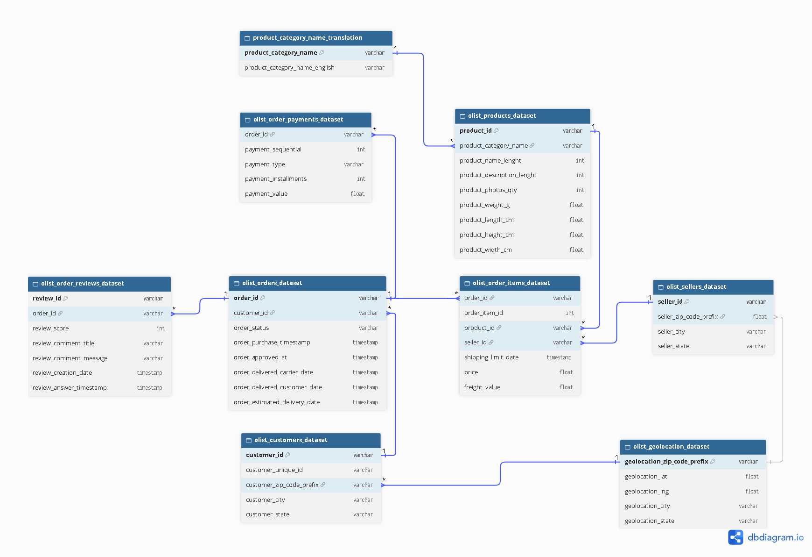

# Olist E-Commerce Analysis

Analisis end-to-end terhadap data e-commerce nyata dari Olist (platform marketplace Brasil), mencakup data cleaning, SQL querying, analisis statistik dengan Python, dan dashboard interaktif di Power BI.

## Latar Belakang

Project ini dibuat sebagai portfolio data analyst, menggunakan dataset transaksi e-commerce nyata untuk menjawab pertanyaan bisnis seputar revenue, kepuasan pelanggan, loyalitas, dan performa operasional (pengiriman).

## Sumber Data

Dataset: Brazilian E-Commerce Public Dataset by Olist
Link: https://www.kaggle.com/datasets/olistbr/brazilian-ecommerce

Untuk menjalankan ulang project ini, download dataset dari link di atas dan letakkan file CSV di folder `data/raw/`.

## Tools yang Digunakan

- **PostgreSQL** — database & SQL querying
- **Python (pandas)** — data cleaning lanjutan, RFM analysis, cohort retention analysis
- **dbdiagram.io** — perancangan ERD
- **Power BI** — dashboard interaktif

## Business Questions

1. Kategori produk mana yang paling menguntungkan dan paling banyak dikeluhkan?
2. Apakah keterlambatan pengiriman berkorelasi dengan rating rendah?
3. Bagaimana tren penjualan bulanan, dan wilayah (state) mana penyumbang revenue terbesar?
4. Metode pembayaran apa yang paling sering dipakai, apakah ada perbedaan pola antar wilayah?
5. Berapa rata-rata waktu pengiriman vs estimasi, dan seller mana yang paling sering telat?
6. Bagaimana rata-rata tingkat kepuasan (rating) pelanggan di tiap wilayah?

## Temuan Utama

- Kategori `cama_mesa_banho` masuk top-3 revenue tertinggi, namun juga kategori dengan keluhan (rating rendah) terbanyak
- Keterlambatan pengiriman terbukti berkorelasi kuat dengan rating rendah (rating turun dari 4.30 ke 1.74 untuk order yang tidak sampai)
- São Paulo (SP) mendominasi revenue nasional, 2.8x lipat dari runner-up
- Lebih dari 75% pelanggan Olist hanya bertransaksi satu kali (tingkat retensi sangat rendah)
- Estimasi waktu pengiriman saat ini (24.4 hari) jauh lebih longgar dibanding waktu aktual (12.5 hari)

## Struktur Project
\`\`\`
olist-ecommerce-analysis/
├── data/
│   ├── raw/
│   └── processed/
├── sql/
│   ├── 01_schema.sql
│   ├── 02_EDA.sql
│   ├── 03_cleaning.sql
│   └── 04_business_questions.sql
├── notebooks/
│   ├── 01_rfm_analysis.ipynb
│   └── 02_cohort_retention_analysis.ipynb
├── docs/
│   ├── erd.png
│   ├── decision_log.md
│   └── progress_log.md
└── dashboard/
    ├── screenshot/
    │   ├── screenshot_overview.jpg
    │   ├── screenshot_customer_loyalty.jpg
    │   └── screenshot_operational_issues.jpg
    ├── olist_ecommerce_dashboard.pbix
    └── olist_ecommerce_dashboard.pdf
\`\`\`

## ERD (Entity Relationship Diagram)

## Dashboard

Link dashboard (Power BI): -

### Overview

### Customer Loyalty

### Operational Issues

## Author
[Alexandro Kalindra](www.linkedin.com/in/alexandro-k)